# Assignment 6 – jQuery: Selectors, Effects and Animations

Amirgaliyeva Saida
IT-2513

Objective:
The objective of this assignment is to learn how to use jQuery to select HTML elements, change webpage content and styles, handle user actions, and create animations and effects.

Description:
I created a webpage called "Brighten Moments". It is a personal webpage about small things that can make everyday life a little brighter. The webpage includes the following tasks:

Part 1.
Task 0 – jQuery Setup
Connected the jQuery library and used "$(document).ready()" to make sure the code runs after the page is loaded.
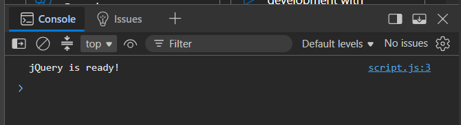

Task 1 – Selectors and Content
Used tag, ID, and class selectors. Changed text and styles using jQuery and added light and dark themes.
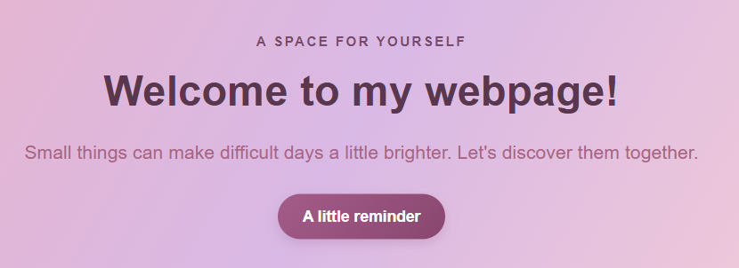
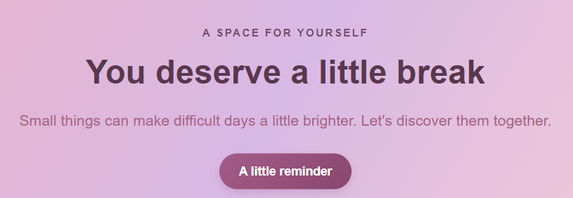

Part 2.
Task 2 – Hide, Show and Toggle
Added buttons to hide, show, and toggle the visibility of a text section using ".hide()", ".show()", and ".toggle()".
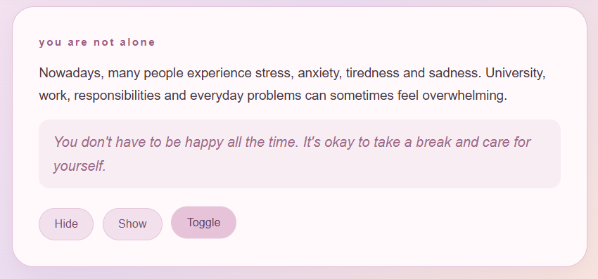

Task 3 – Fade Effects
Added buttons to show, hide, and toggle gallery images using ".fadeIn()", ".fadeOut()", and ".fadeToggle()".           
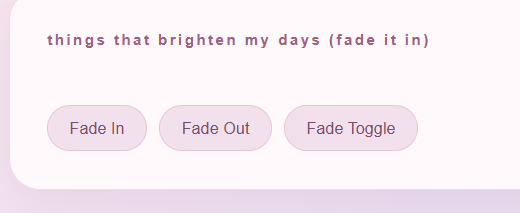
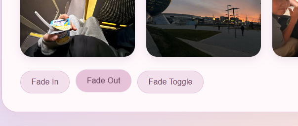

Task 4 – Slide Effects
Created interactive panels for music, movies, and applications. Used ".slideUp()", ".slideDown()", and ".slideToggle()" to open and close the panels.
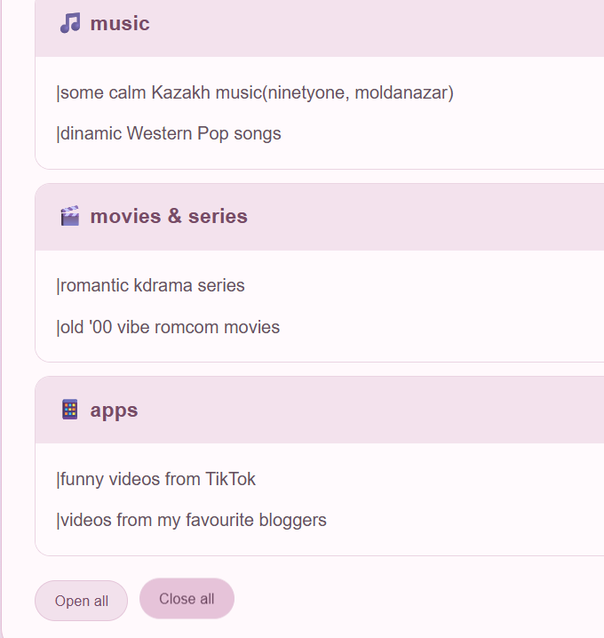
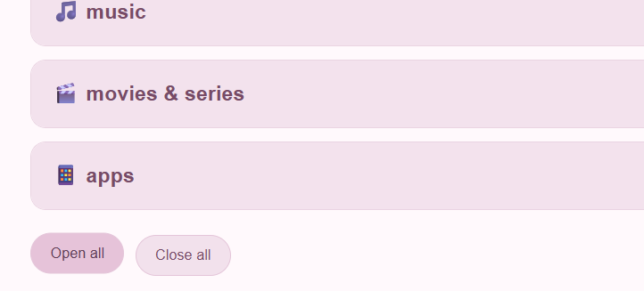

PArt 3.
Task 5 – Working with Lists
Created a list of activities and added buttons to insert new ideas at the beginning or end of the list and remove the last item using ".append()", ".prepend()", and ".remove()".
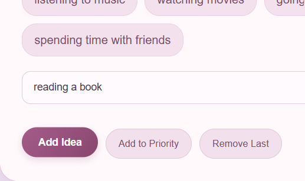

Task 6 – Changing Links
Added a link that switches between Outlook and Gmail using the ".attr()" method.

Task 7 – Form and Live Preview
Created a form with name and email fields. Used ".val()" to get input values and ".text()" to display them immediately in the preview section.
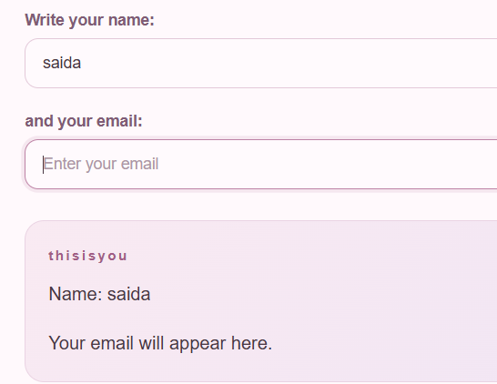

Part 4.
Task 8 – Animations
Created three animated progress bars and used ".animate()" to increase their width. Clicking the button again returns the bars to zero.
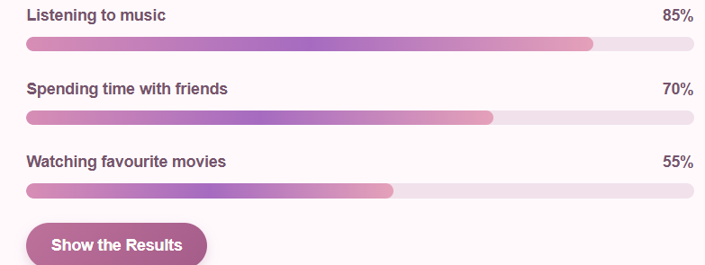

Final Result:
The webpage combines different jQuery features in one interactive project. During this assignment, I learned how to use selectors, change webpage content and styles, handle user interactions, work with forms, and create animations.
